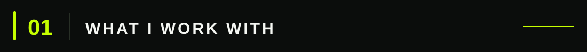
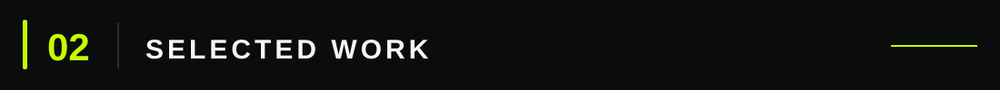
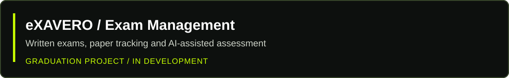
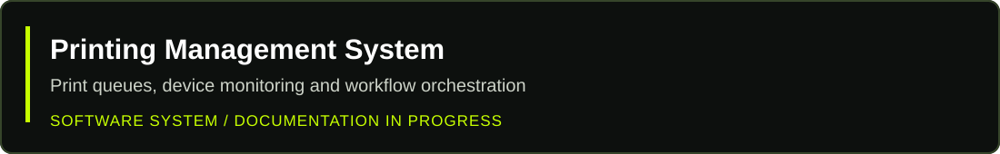
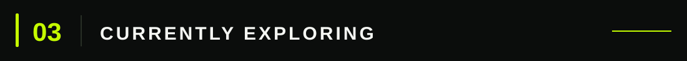

  

 

### Building practical digital products through code and design.

I'm **Ahmed Abdelkhaleq**, a Computer Science student at Zagazig University (Class of 2027), software developer, and visual designer based in Egypt. I enjoy turning complex problems into clear, usable digital experiences — from backend systems to interfaces and visual identities.

[**Portfolio ↗**](https://portfolio.ajcore.net/ar) · [**GitHub ↗**](https://github.com/Ahmedaljallad)

 

| Development | Design & Tools |
| :--- | :--- |
| Python · C++ · JavaScript · SQL | UI/UX · Visual Identity · Design Systems |
| FastAPI · React · HTML · CSS | Photoshop · Illustrator · Figma |
| Git · GitHub · REST APIs | Interface Design · Prototyping |

 

A graduation project focused on written-exam workflows, paper identification and tracking, and AI-assisted hybrid assessment. **In development; source code currently private.**

A system for coordinating print jobs, monitoring printers, and managing print workflows across connected devices. *Project documentation coming soon.*

**[Design Portfolio ↗](https://portfolio.ajcore.net/ar)** — Selected visual identity, digital design, and client work.

 

Data Structures & Algorithms · Backend Architecture · Databases · Practical Software Engineering

---

  <strong>Let's build something useful.</strong> 
  Code with purpose. Design with clarity.

